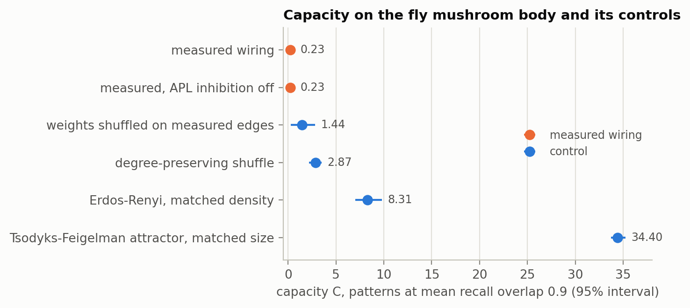
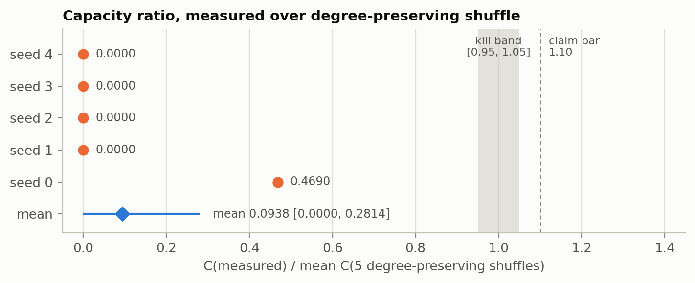
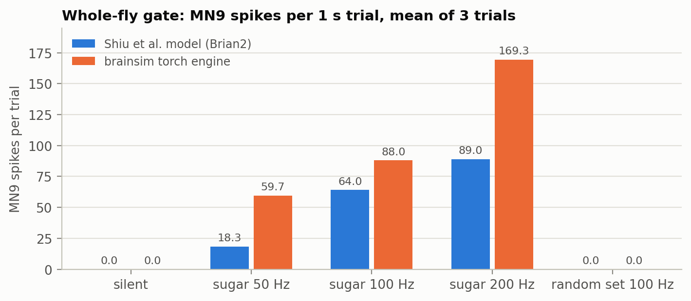
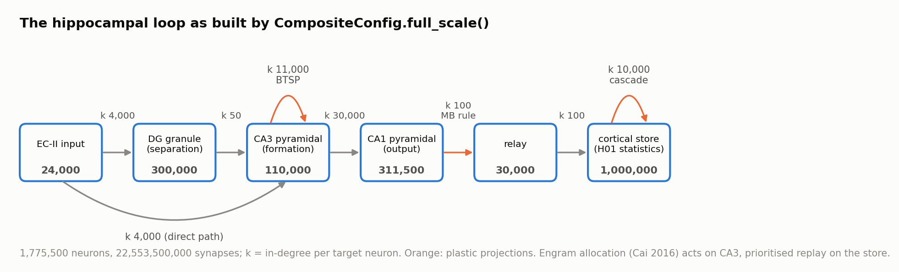

# brainsim: memory circuits on connectome wiring

A simulator for memory circuits on connectome wiring, with one measured result
on the fly mushroom body and a hippocampal-loop model parameterised by
published rodent statistics that has run at smoke scale.

The question behind it is simple. A brain region is wired in one particular
way. If you keep every neuron and every synapse count but shuffle who connects
to whom, does the circuit remember more, less, or the same? brainsim builds the
circuit from measured wiring, lets it learn with plasticity rules taken from
the neuroscience literature, measures how many memories it holds, and then
does the same on matched random graphs.

brainsim is the connectome track of **MemBrain**, a research programme on
long-term memory for LLM agents built on how human memory works. The agent
side ships as the Claude Code plugin
[lesson-recall](https://github.com/tr4m0ryp/lesson-recall).

## What it does

```
connectome or statistics
  -> canonical connectivity table   (pre, post, synapse count, sign)
  -> sparse network                 (LIF spiking engine on numpy or torch, or a rate model)
  -> plasticity rules               (MB dopamine rule, BTSP, STDP, Fusi-Abbott cascade,
                                     engram allocation, prioritised replay)
  -> memory protocol                (store P patterns, recall from half-deleted cues)
  -> capacity C                     (largest P recalled at mean overlap 0.9)
  -> same protocol on null graphs   (degree-preserving shuffle, weight shuffle,
                                     Erdos-Renyi, matched attractor)
  -> frozen verdict                 (thresholds committed before any result-bearing run)
```

**Three experiments.** Their state at a glance:

| Experiment | Wiring | State |
|---|---|---|
| Fly mushroom body, capacity ratio | FlyWire v783, measured: 5,960 neurons, 801,645 synapses | measured, 5 seeds: ratio 0.0938 |
| Whole-fly engine gate | FlyWire v783, measured: 138,639 neurons, 15,091,983 connection pairs | passed |
| Hippocampal loop (DG, CA3, CA1, cortical store) | built from published mouse and rat statistics plus H01 statistics | built; run at smoke scale (2,000 neurons); full scale 1,775,500 neurons, 2.2554e10 synapses is the next step |

**One engine, two backends.** The numpy engine is the reference. The torch
engine is matched to it on an engineered pulse network, runs fp16 weights with
fp32 accumulation, and shards a network across GPUs by postsynaptic neuron. On
one node with 8 H200 GPUs it ran 5e10 synapses at 156.86 wall seconds per
simulated second.

## How it works, and why

Every measured number below is copied from a result file in
[`results/`](./results) and carries its setup; the sizes of the hippocampal
loop are read from its configuration in code.
[`docs/figures/data.json`](./docs/figures/data.json) names the source file and
field of each plotted value. Every equation is read off the code; the file is
named with it.

### The question: does measured wiring buy memory?

Let $`G`$ be a measured circuit and $`\mathcal{N}(G)`$ a family of null graphs
that keep the same neurons, the same in- and out-degree of every neuron and
the same multiset of synapse counts, but rewire the edges. Run one memory
protocol on both and measure the capacity $`C`$. The wiring premium is

```math
R \;=\; \frac{C(G)}{\mathbb{E}_{G' \sim \mathcal{N}(G)}\big[C(G')\big]}
```

$`R > 1`$ means the measured wiring stores more than wiring with the same
degrees would. $`R = 1`$ means the degrees explain everything. $`R < 1`$ means
the specific wiring stores less than its own shuffles: an anti-premium.

### Neurons: leaky integrate-and-fire

`src/brainsim/engine/lif.py` and `src/brainsim/engine/propagate.py`. Each neuron
has a membrane potential $`v`$ and a synaptic current $`I`$. One step of
$`\Delta t`$:

```math
v_{t+1} = \begin{cases} v_t + \dfrac{\Delta t}{\tau_m}\Big(-(v_t - v_{\mathrm{rest}}) + R\,I_t\Big) & \text{if not refractory} \\[4pt] v_{\mathrm{reset}} & \text{otherwise} \end{cases}
\qquad s_{t+1} = \mathbf{1}\big[v_{t+1} \ge v_{\mathrm{th}}\big], \qquad I_{t+1} = I_t\, e^{-\Delta t/\tau_s}
```

A spike resets $`v`$ to $`v_{\mathrm{reset}}`$ and blocks integration for
$`\mathrm{round}(t_{\mathrm{ref}}/\Delta t)`$ steps. A spike of presynaptic
neuron $`j`$ adds the signed weight to every target after $`d`$ steps, through
a ring buffer over a CSR table:

```math
I_i \;\leftarrow\; I_i + \sum_{j \to i} \sigma_{ij}\, w_{ij}\, s_j(t - d), \qquad \sigma_{ij} \in \{-1, +1\}
```

Defaults: $`v_{\mathrm{rest}} = v_{\mathrm{reset}} = -52`$ mV,
$`v_{\mathrm{th}} = -45`$ mV, $`\tau_s = 5`$ ms, $`t_{\mathrm{ref}} = 2.2`$ ms
(the whole-fly constants of [Shiu et al., Nature
2024](https://doi.org/10.1038/s41586-024-07763-9)), $`\tau_m = 20`$ ms,
$`R = 1`$, $`\Delta t = 1`$ ms.

### Plasticity rules

`src/brainsim/rules/` holds one numpy reference per rule and
`src/brainsim/rules/torch_rules/` the torch ports, which
`tests/rules/test_torch_rules_equivalence.py` checks against the references.

**Mushroom-body dopamine rule** (`mb_rule.py`, after [Jiang and Litwin-Kumar,
PLOS CB 2021](https://doi.org/10.1371/journal.pcbi.1009205)). A Kenyon cell
(KC) spike sets an eligibility trace to 1, the trace decays with $`\tau_e`$,
and a coincident dopamine signal $`d`$ depresses the KC to output synapse:

```math
e_j \leftarrow \begin{cases} 1 & s_j = 1 \\ e_j\, e^{-\Delta t/\tau_e} & \text{otherwise} \end{cases}
\qquad
w_{ij} \leftarrow \mathrm{clip}\Big(w_{ij} - \alpha\, \frac{e_j\, d_i}{\tau_W}\,\Delta t,\;\; \beta,\;\; w_{\max}\Big)
```

with $`\alpha = 1`$, $`\tau_W = 5`$ s, $`\tau_e = 200`$ ms,
$`w_{\max} = 0.05`$, floor $`\beta = 0`$.

**Behavioural-timescale plasticity, BTSP** (`btsp.py`, [Milstein et al., eLife
2021](https://doi.org/10.7554/eLife.67111)). A presynaptic eligibility trace
$`\mathrm{ET}`$ ($`\tau = 864`$ ms) and a postsynaptic plateau signal
$`\mathrm{IS}`$ ($`\tau = 543`$ ms) form a coincidence $`c = \mathrm{ET}_j\,
\mathrm{IS}_i`$ that drives a self-limiting update:

```math
\Delta w_{ij} = \Big[(w_{\max} - w_{ij})\, k_+\, q_+(c) \;-\; w_{ij}\, k_-\, q_-(c)\Big]\frac{\Delta t}{1000},
\qquad q(c) = \max\!\Big(0,\; \frac{\varsigma(a(c - m)) - \varsigma(-a m)}{1 - \varsigma(-a m)}\Big)
```

where $`\varsigma`$ is the logistic function, $`a = 12`$, $`m = 0.5`$, and
$`q(0) = 0`$, so no plateau means no change.

**Spike-timing-dependent plasticity** (`stdp.py`, [Bi and Poo, J Neurosci
1998](https://doi.org/10.1523/JNEUROSCI.18-24-10464.1998)). Pair-based, with
traces $`x^{\mathrm{pre}}`$ ($`\tau_+ = 17`$ ms) and $`x^{\mathrm{post}}`$
($`\tau_- = 34`$ ms) that grow by 1 per spike: a postsynaptic spike adds
$`A_+ x^{\mathrm{pre}}_j`$ to $`w_{ij}`$, a presynaptic spike subtracts
$`A_- x^{\mathrm{post}}_i`$, with $`A_+ = 0.01`$, $`A_- = 0.012`$, clipped to
$`[0, 1]`$.

**Fusi-Abbott cascade** (`cascade.py`, [Fusi et al., Neuron
2005](https://doi.org/10.1016/j.neuron.2005.02.001)). Each synapse is one byte:
one of $`2n`$ states, $`n = 8`$ depressed and $`n`$ potentiated levels. Its
readout weight is the branch. An event at depth $`i`$ (1 = shallowest) moves it
one level with probability

```math
q_i = q_1\, x^{\,i-1}, \qquad q_1 = 0.5,\; x = 0.5
```

so deep states resist both learning and noise. A deterministic `deepen`
operation installs protection.

**Engram allocation** (`allocation.py`, [Cai et al., Nature
2016](https://doi.org/10.1038/nature17955)). Each neuron carries an
excitability $`\epsilon_i`$ that decays with $`\tau = 36`$ h. An event picks
the top $`k`$ of $`\epsilon_i + \mathcal{N}(0, 0.1^2)`$ and adds 1 to their
excitability, so events close in time share neurons.

**Prioritised replay** (`replay.py`, after [Kali and Dayan, Nat Neurosci
2004](https://doi.org/10.1038/nn1202)). An offline phase samples 10 stored
items with replacement, with probability proportional to their salience, and
re-writes each at 0.05 times the online learning rate.

### The fly mushroom-body protocol

`src/brainsim/batteries/h1/`. The circuit is the complete bilateral mushroom
body of FlyWire v783, selected by cell-type annotation, never by connectivity:
685 projection neurons (PN), 5,177 Kenyon cells (KC), 96 output neurons (MBON),
331 dopaminergic neurons (DAN) and 2 APL neurons, 5,960 neurons in all. The
circuit uses the PN to KC, KC to MBON, KC to APL and APL to KC projections:
100,518 connected pairs carrying 801,645 synapses. Connection strength is the
anatomical synapse count.

**Rate model** (`circuit.py`). A pattern $`x`$ on the PNs drives the KCs
through the measured counts $`W_{PK}`$. The KC code is the top $`K`$ of the
drive, re-ranked by the measured APL feedback loop:

```math
h = x\,W_{PK}, \quad y_0 = \mathrm{top}_K(h), \quad u = (y_0 W_{KA})\, W_{AK}^{\top}, \quad g = \gamma\,\frac{\overline{h}}{\overline{u}}, \quad y = \mathrm{top}_K\big(h - g\,u\big)
```

with $`K = \mathrm{round}(f_{KC}\, n_{KC})`$, $`f_{KC} = 0.05`$, and
$`\gamma = 1`$ ($`\gamma = 0`$ is the inhibition knockout). The rate model was
chosen because full spiking at capacity-sweep load did not fit the CPU budget;
the frozen contract pins the rule, not the neuron model.

**Write.** Each stored item pairs a PN pattern ($`f_{PN} = 0.10`$) with a
target set $`z`$ of MBONs ($`f_z = 0.125`$, 12 of 96) that receive dopamine.
Holding a 100 ms presentation with $`e_j = 1`$ and $`d_i = 1`$ in the MB rule
gives a closed form, tested step for step against the rule:

```math
w_{ij} \leftarrow \mathrm{clip}\big(w_{ij} - \Delta w,\; 0,\; w_{\max}\big) \quad \text{for } y_j = 1,\; i \in z, \qquad \Delta w = \frac{\alpha\, T\, \Delta t}{\tau_W} = \frac{100}{5000} = 0.02 = 0.4\, w_{\max}
```

**Recall.** A cue keeps a random half of the item's active PNs and adds
nothing. With $`M`$ the anatomical KC to MBON counts, the response of each MBON
is compared with the untrained circuit:

```math
m = y_{\mathrm{cue}}\,(M \odot W), \qquad m^0 = w_{\max}\, y_{\mathrm{cue}} M, \qquad \sigma_i = 1 - \frac{m_i}{m^0_i}, \qquad \mathrm{overlap} = \frac{|\mathrm{top}_{|z|}(\sigma) \cap z|}{|z|}
```

### Capacity and the capacity ratio

`src/brainsim/batteries/h1/protocol.py` and `fly_arm.py`. Items are streamed
into one circuit. At checkpoints $`P = 1, 2, 3, 4, 5, 6, 8, 10, 13, \dots`$
(ratio 1.3, up to 24,576) the mean overlap $`\bar o(P)`$ is measured on up to
200 stored items. Capacity is the largest load still recalled at the bar,
interpolated linearly into the next checkpoint:

```math
C = P_a + \frac{\bar o(P_a) - 0.9}{\bar o(P_a) - \bar o(P_{a+1})}\,(P_{a+1} - P_a), \qquad P_a = \max\{P : \bar o(P) \ge 0.9\}
```

and $`C = 0`$ when no checkpoint reaches 0.9. The capacity ratio of seed
$`s`$ divides by the mean over 5 degree-preserving shuffles, and the reported
interval is a percentile bootstrap over seeds (10,000 resamples):

```math
R_s = \frac{C_s(G)}{\tfrac{1}{5}\sum_{d=1}^{5} C_s(G'_{s,d})}, \qquad \bar R = \tfrac{1}{5}\sum_{s=0}^{4} R_s
```

Every arm of a seed sees the same item bank, so the comparison is paired.

### The matched null graphs

`src/brainsim/batteries/h1/controls.py` and `tf_arm.py`.

- **Degree-preserving shuffle (the denominator):** Maslov-Sneppen double-edge swaps on PN to KC and on KC to MBON, $`10E`$ attempts per projection, swaps that would duplicate an edge rejected. In-degree, out-degree and each source's weight multiset are kept. The two APL neurons cannot be rewired by swaps, so their weight profiles are permuted across KCs.
- **Weight shuffle:** the measured edges stay, the synapse counts are permuted across them.
- **Erdos-Renyi:** same node sets and edge count per projection, uniform random pairs, permuted measured weights.
- **Tsodyks-Feigelman attractor:** a recurrent network with one unit per PN, KC, MBON and APL neuron of the circuit and as many synaptic entries as the circuit has synapses, trained with $`J_{ij} = \sum_\mu (\xi^\mu_i - f)(\xi^\mu_j - f)`$ on its edges and recalled with 15 k-winner-take-all iterations. It is the capacity reference of a classic attractor memory at the same resource.

### The gates

**Pre-registered verdict** (`src/brainsim/batteries/verdicts.py`). The battery
contracts were frozen before any result-bearing run; their SHA-256 hashes are
in the file and in every result. For the wiring premium the claim bar is
$`\bar R > 1.10`$ at overlap 0.9, and the kill band is every $`R_s`$ in
$`[0.95, 1.05]`$ on both the fly arm and the hippocampal-loop arm. Drivers call
these functions and never re-type a threshold.

**Engine gate.** Before any memory number, the engine has to reproduce known
whole-fly behaviour. The checks follow Shiu et al.: driving the sugar
gustatory receptor neurons (20 of 21 map in v783) must make motor neuron MN9 fire above the silent
baseline, MN9 must rise with drive frequency, and sugar must beat a random set
of the same size. The reference run executes Shiu et al.'s own Brian2 model;
the brainsim run maps their constants onto `LIFParams`
(`src/brainsim/validate/whole_fly/mapping.py`): synapse weight 0.275 mV times
the signed synapse count, delay 1.8 ms to 2 steps, refractory 2.2 ms to 2
steps, and each Poisson input event drawn as Bernoulli($`r\Delta t`$) and
injected as $`I_{\mathrm{EV}} = w_{\mathrm{syn}} f_{\mathrm{poi}} = 68.75`$ mV
into $`I`$. The file lists five divergences from the Brian2 model (reset keeps
$`I`$, refractory handling, driven neurons keep refractory, Bernoulli versus
Poisson, Euler at 1 ms versus exact integration at 0.1 ms); none of them
reverses a checked direction.

**H01 statistics gate** (`src/brainsim/batteries/h2/twin.py`). The cortical
store is generated from H01 statistics: the multi-contact distribution trimmed
to $`k \le 50`$ contacts per connection and a lognormal strength prior with
$`\sigma_{\ln} = 1.0996`$ fitted on excitatory synapse volumes. A generated
store is checked against the statistics with Kolmogorov-Smirnov distances
before any arm may run on it.

### Experiment 1: fly mushroom body, measured

**Setup.** FlyWire v783 mushroom body as above; 5 seeds; per seed the measured
circuit, the inhibition knockout, 5 degree-preserving shuffles, a weight
shuffle, an Erdos-Renyi graph and the attractor reference; numpy rate model on
CPU, runtime 279.9 s. Source: [`results/h1/fly_arm.json`](./results/h1/fly_arm.json).

**Result.** The measured circuit stores fewer patterns than every null graph.

| Arm | C, mean over 5 seeds | 95% interval |
|---|---|---|
| measured wiring | 0.2267 | [0.0, 0.68] |
| measured, APL inhibition off | 0.2267 | [0.0, 0.68] |
| weights shuffled on measured edges | 1.44 | [0.28, 2.84] |
| degree-preserving shuffle | 2.8662 | [2.2078, 3.5133] |
| Erdos-Renyi, matched density | 8.3083 | [7.0276, 9.8139] |
| Tsodyks-Feigelman attractor, matched size | 34.3991 | [33.7438, 35.2226] |

<picture>
  <source media="(prefers-color-scheme: dark)" srcset="docs/figures/png/capacity-arms-dark.png">
  
</picture>

*FlyWire v783 mushroom body, 5 seeds, rate model with the MB dopamine rule:
the measured wiring holds 0.23 patterns at overlap 0.9, its degree-preserving
shuffles 2.87, a random graph of the same density 8.31.*

The **capacity ratio is 0.0938**, 95% interval [0.0000, 0.2814], Cohen's d
-3.8737 between measured and shuffled capacity. Per seed the ratio is 0.4690,
0, 0, 0, 0: on four of five seeds the measured circuit never reaches overlap
0.9, even at one stored pattern. In plain words: under this rule and this
recall protocol, the fly's own wiring holds about a tenth of what the same
neurons with the same degrees, wired at random, hold. The value sits below the
kill band [0.95, 1.05], so it neither clears the claim bar nor counts as "no
effect": it is an anti-premium. The frozen contract names no verdict below the
band, and the result file labels the fly arm `between_band_and_bar`, its term
for "not supported and not killed"; the formal H1 verdict is decided together
with the hippocampal-loop arm.

<picture>
  <source media="(prefers-color-scheme: dark)" srcset="docs/figures/png/capacity-ratio-dark.png">
  
</picture>

*Same run: every seed lies below the pre-registered kill band and claim bar.*

**Inhibition knockout.** Setting $`\gamma = 0`$ changes capacity by exactly 0
on every seed. The APL term re-ranks about 13% of each KC code, but capacity
sits at the resolution floor of the protocol, so the knockout cannot resolve a
difference at this operating point.

**Calibration before the run.** Two launches were stopped before any capacity
or ratio was computed: the target density moved from 0.5 to 0.125 and the
write from 200 to 100 ms because every arm saturated by P = 17, and the cue
became a pure deletion after the first cue model replaced deleted PNs with
random ones. Both changes apply to every arm; the frozen thresholds were not
touched. The history is recorded in `protocol.py` and in the result file.

### Experiment 2: whole-fly engine gate, passed

**Setup.** FlyWire v783 whole brain as distributed with Shiu et al.'s model:
138,639 neurons, 15,091,983 connection pairs, brainsim torch engine on CPU in
fp32, 3 trials of 1 s per condition, seeds 1000 + trial, runtime 93.0 s.
Source: [`results/fly-gate/brainsim/gate.json`](./results/fly-gate/brainsim/gate.json).
Reference: Shiu et al.'s Brian2 model on the same connectome, 3 trials
([`results/fly-gate/shiu-brian2/gate.json`](./results/fly-gate/shiu-brian2/gate.json)).

**Result.** All three checks pass on both engines.

| MN9 spikes per trial, mean of 3 | silent | sugar 50 Hz | sugar 100 Hz | sugar 200 Hz | random set 100 Hz |
|---|---|---|---|---|---|
| Shiu et al. model (Brian2) | 0.0 | 18.3 | 64.0 | 89.0 | 0.0 |
| brainsim torch engine | 0.0 | 59.7 | 88.0 | 169.3 | 0.0 |

<picture>
  <source media="(prefers-color-scheme: dark)" srcset="docs/figures/png/fly-gate-dark.png">
  
</picture>

*Whole fly brain, 3 trials per condition: both engines are silent without
drive, rise with sugar frequency, and stay silent under a random input set.
Absolute rates differ by design: the gate checks directions.*

The gate is directional by pre-registration. The first event mapping injected
the charge equivalent of Shiu's voltage jump, $`I_{\mathrm{EV}} = 275`$ mV;
at 200 Hz it drove the network into a runaway state of about 1.2 million spikes
per trial, MN9 fell to 56.0 against 166.7 at 50 Hz, and dose-response failed
([`gate-attempt-charge-iev275.json`](./results/fly-gate/brainsim/gate-attempt-charge-iev275.json)).
The pre-authorised alternative, 68.75 mV added like a network synapse, passed
and is the default. At 200 Hz the three trials gave 249, 221 and 38 MN9 spikes.

### Experiment 3: the hippocampal loop, built and run at smoke scale

`src/brainsim/composite/full/`. A spiking loop from entorhinal input through
dentate gyrus (separation), CA3 (formation), CA1 (output) and a thin relay into
a cortical store. Stage sizes and the main in-degrees come from published
mouse and rat statistics, and the remaining in-degrees are engineering choices
marked field by field in `config.py`; the store's contact and strength statistics come from H01, human
temporal cortex, used as a statistical source and not as a reconstruction. The
synapse strength ceiling of 26 states is the number Bartol et al. measured on
Harris lab rat CA1 serial-section EM ([eLife
2015](https://doi.org/10.7554/eLife.10778)). No measured mouse or rat wiring
enters the loop.

<picture>
  <source media="(prefers-color-scheme: dark)" srcset="docs/figures/png/hippocampal-loop-dark.png">
  
</picture>

*Read from `CompositeConfig.full_scale()` and `build.edge_specs`: neuron count
per stage, in-degree k per projection, and the rule on each plastic projection.*

Writing an item drives the input pattern through the loop in 30-step windows.
CA3 picks its engram by allocation and binds it with BTSP on the recurrent
synapses, with recurrent weights scaled by $`\rho = 2^{-4}`$ during encoding
(acetylcholine-gated suppression after Hasselmo). The relay applies the MB rule
with dopamine set by salience, and the store writes slowly under cascade
protection; a prioritised replay transfer into the store is built in and set
to a budget of 0 in the default configuration. Recall clamps a degraded
cue and reads each recurrent stage as the iterated synaptic image of the cue
through the live weights. A direct input to CA3 path ($`k = 4000`$) carries
retrieval cues, as in the Treves-Rolls account of CA3.

**State.** At full scale, `build.forecast(CompositeConfig.full_scale(), 8)`
gives 1,775,500 neurons and 22,553,500,000 synapses (2.2554e10), 14.68 bytes
per synapse and 41.4 GB per GPU on 8 GPUs. The loop has run at smoke scale:
2,000 neurons (`CompositeConfig.smoke()`, in-degrees 20 to 40), 30-step write
and recall windows of 1 ms, 5 items per cycle, in `tests/composite/`. Smoke runs
check code paths; their numbers are not results, and the battery drivers
refuse to write a results file from them.

**Roadmap.** The full-scale run needs one node with 8 GPUs that each hold
41.4 GB of state. The recalibrated throughput fit
([`results/bench/recalibration.json`](./results/bench/recalibration.json):
3.622 ms fixed cost per step, 1.053e11 synaptic events per second) puts a
5e10-synapse composite driven at 3 Hz at 5.05 wall seconds per simulated
second. The batteries run in the order H2, H1 loop arm, H3:

- **H2, permanence:** does the H01 multi-contact motif move the retention-capacity frontier beyond uniform strengthening, cascade alone or replay alone at matched resources?
- **H1, loop arm:** the capacity ratio of the formation loop against its own degree-preserving shuffles; together with the fly arm it decides the frozen H1 verdict.
- **H3, composite against its parts:** does the loop retain at least 1.25 times what its best single stage retains, and which cell types or motifs does a knockout screen flag?
- **Measured mouse wiring:** replacing the statistics-built formation stage with measured CA3 and CA1 wiring once access to those volumes is granted.

### Throughput

[`results/bench/benchmark.json`](./results/bench/benchmark.json), torch engine
sharded over 8 H200 GPUs with NCCL, fp16 weights, 305 Hz drive, 200 steps:

| Synapses | Neurons x in-degree | 200 steps, elapsed s | Synaptic events per s |
|---|---|---|---|
| 1e9 | 1,000,000 x 1,000 | 1.3647 | 4.41e10 |
| 1e10 | 2,500,000 x 4,000 | 7.0282 | 8.68e10 |
| 5e10 | 5,000,000 x 10,000 | 31.3713 | 9.72e10 |

At 5e10 synapses that is 156.86 wall seconds per simulated second
(`wall_s_per_sim_s`); the per-point event rates are in `bench_8gpu_*.json`.

## Install

```
git clone https://github.com/tr4m0ryp/brainsim
cd brainsim
python3 -m venv .venv && . .venv/bin/activate
pip install -e ".[test]"
```

Python 3.11 or newer. The dependencies are pinned to the versions the results
were produced with: numpy 1.26.4, scipy 1.17.1, torch 2.2.2. On a machine
without a GPU, install the CPU wheel of torch first:
`pip install torch==2.2.2 --index-url https://download.pytorch.org/whl/cpu`.
Extras: `flywire` (pyarrow, for the connectome conversion), `shiu` (Brian2,
pandas, pyarrow, for the reference gate), `figures` (matplotlib).

## Run

**Tests.** No dataset needed; the batteries run on small synthetic graphs and
on the H01 statistics tables shipped in `data/`.

```
pip install -e ".[flywire]"
pytest
```

165 passed and 1 skipped on CPU in under 2 minutes, with the `test` and
`flywire` extras installed. The skipped test covers the case where pyarrow is
absent.

**Toy example.** A random mushroom-body-shaped graph (150 PN, 1,500 KC, 32
MBON, 2 APL), spiking pass and capacity protocol end to end on CPU in about
20 seconds:

```
python examples/toy_capacity.py
```

```
synthetic graph: 150 PN, 1500 KC, 32 MBON, 2 APL
spiking pass: 1682 LIF neurons, 28200 connections, 300 steps of 1 ms
  spikes per population: {'PN': 1636, 'KC': 18138, 'MBON': 3040}
  mb_rule: gated KC->MBON weight mean 0.0184 (w_max 0.05), ungated unchanged at 0.0500
capacity pass: f_pn 0.1, f_kc 0.05, f_z 0.125, overlap bar 0.9, cues 50% deleted, seeds [0, 1, 2]
  seed 0: C(graph) 8.22, C(degree-preserving shuffle, mean of 3) 7.67, ratio 1.072
  seed 1: C(graph) 8.40, C(degree-preserving shuffle, mean of 3) 11.52, ratio 0.729
  seed 2: C(graph) 10.95, C(degree-preserving shuffle, mean of 3) 6.89, ratio 1.590
  mean ratio over seeds 1.130 (synthetic graph, not a measurement of any animal)
```

A random graph against its own shuffles lands near a ratio of 1, as it
should: it has no wiring to lose.

**Smoke runs of the batteries** (code paths; they print to the console and write no result):

```
python scripts/batteries/battery_h1.py --arm fly --smoke
python scripts/batteries/battery_h2.py --engine numpy --scale smoke
python scripts/batteries/battery_h3.py --engine torch --scale smoke
```

**Throughput benchmark:** `python -m brainsim.bench --smoke` on CPU;
`scripts/bench/launch_ranks.sh N -- --n ... --k ...` for N ranks.

## Reproduce

**Fly mushroom body** (0.9 GB download, about 5 minutes on 8 CPU cores):

```
pip install -e ".[flywire]"
python scripts/data/fetch_flywire.py
python scripts/batteries/battery_h1.py --arm fly
```

This writes `results/h1/fly_arm.json`. Re-run from this repository on
2026-11-12 against the same FlyWire files (SHA-256 checked), in 268.4 s: every
capacity curve, every per-seed ratio, the ratio interval and the knockout came
out identical to the shipped file.

**Whole-fly engine gate** (about 1 to 2 minutes on CPU):

```
bash scripts/data/fetch_shiu_model.sh
python scripts/gates/fly_gate_brainsim.py
```

Re-run from this repository on 2026-11-12, in 64.9 s: gate passed with the
same MN9 counts per trial and the same network spike counts in every
condition. The reference gate on Shiu et al.'s Brian2 model is
`python scripts/gates/fly_gate_shiu.py` with the `shiu` extra (Brian2 2.10.1);
re-run on 2026-11-12 in about 18 minutes, it passed with the same MN9 means
(0.0; 18.3, 64.0, 89.0; 0.0).

**H01 statistics** (streams about 159 GB of the public export and keeps the
aggregates): `python scripts/data/h01_stats.py stream` then
`python scripts/data/h01_stats.py finalize`. The two resulting tables already
ship in `data/connectomes/h01/stats/`.

Data and results can live elsewhere: set `BRAINSIM_DATA` and
`BRAINSIM_RESULTS`.

## Data, licences and citations

No connectome is redistributed here. Each dataset is downloaded from its
source by a script, under its own terms.

| Dataset | Used for | Terms | What ships here |
|---|---|---|---|
| FlyWire v783 connections ([Zenodo 10676866](https://zenodo.org/records/10676866)) | mushroom-body circuit | Zenodo: CC BY 4.0; [flywire.ai](https://flywire.ai/guidelines): CC BY-NC 4.0 for the public release. The stricter terms are followed. | download script with pinned SHA-256; per-class counts inside the result files |
| FlyWire cell-type annotations ([flywire_annotations v2.1.0](https://github.com/flyconnectome/flywire_annotations)) | mushroom-body membership | no licence file in the repository | download script; nothing redistributed |
| Shiu et al. whole-brain model and its v783 tables ([Drosophila_brain_model](https://github.com/philshiu/Drosophila_brain_model)) | engine gate | MIT for the code; the tables derive from FlyWire | clone script at a pinned commit; nothing redistributed |
| H01 human temporal cortex ([release](https://h01-release.storage.googleapis.com/data.html)) | cortical-store statistics | CC BY 4.0 | the two aggregate tables, with attribution |
| Harris lab rat CA1, kharris15 ([neurodata.io](https://neurodata.io/data/kharris15/)) | the 26-state synapse ceiling, through Bartol et al. 2015 | ODC-By 1.0 | nothing; no step downloads it |
| MICrONS mouse visual cortex ([microns-explorer.org](https://www.microns-explorer.org/terms-and-conditions)) | surveyed, not used | CC BY 4.0 | nothing |

If you use results built on these datasets, cite:

- **FlyWire:** Dorkenwald et al., Neuronal wiring diagram of an adult brain, Nature 634, 124-138 (2024), [doi:10.1038/s41586-024-07558-y](https://doi.org/10.1038/s41586-024-07558-y); Schlegel et al., Whole-brain annotation and multi-connectome cell typing of Drosophila, Nature (2024), [doi:10.1038/s41586-024-07686-5](https://doi.org/10.1038/s41586-024-07686-5). The Zenodo record also references Buhmann et al. 2021 (synapse detection), Eckstein et al. 2024 (neurotransmitter prediction) and Heinrich et al. 2018; [Codex](https://codex.flywire.ai/about_flywire) lists the citations per use.
- **Shiu et al.:** A Drosophila computational brain model reveals sensorimotor processing, Nature 634, 210-219 (2024), [doi:10.1038/s41586-024-07763-9](https://doi.org/10.1038/s41586-024-07763-9).
- **H01:** Shapson-Coe et al., A petavoxel fragment of human cerebral cortex reconstructed at nanoscale resolution, Science 384, eadk4858 (2024), [doi:10.1126/science.adk4858](https://doi.org/10.1126/science.adk4858).
- **Harris lab:** Harris et al., A resource from 3D electron microscopy of hippocampal neuropil for user training and tool development, Scientific Data 2, 150046 (2015), [doi:10.1038/sdata.2015.46](https://doi.org/10.1038/sdata.2015.46); data [doi:10.7281/T11Z429Q](https://doi.org/10.7281/T11Z429Q). Bartol et al., Nanoconnectomic upper bound on the variability of synaptic plasticity, eLife 4, e10778 (2015).

## Repository layout

```
src/brainsim/
  engine/            LIF core, CSR propagation, numpy network; torch_core/ (sharded, fp16, fast path)
  rules/             MB rule, BTSP, STDP, cascade, allocation, replay; torch_rules/ ports
  batteries/         verdicts.py (frozen thresholds); h1/ wiring premium, h2/ permanence, h3/ composite
  composite/         numpy pipeline, torch adapter, full/ (the spiking hippocampal loop at any scale)
  circuits/ schema/  stage builders, canonical connectivity table
  validate/          whole_fly/ engine gate
  bench/             throughput harness
  paths.py           BRAINSIM_DATA and BRAINSIM_RESULTS
scripts/             data/ downloads, gates/ engine gates, batteries/ drivers, bench/ multi-rank launcher
tests/               engine/, rules/, batteries/, composite/
examples/            toy_capacity.py
results/             h1/ fly arm, fly-gate/ both gates, bench/ throughput
docs/figures/        plot.py, data.json, png/, svg/
data/                downloads land here (gitignored), plus the H01 statistics tables
```

Labels such as F21 or T8 in code comments refer to findings and build tasks of
the MemBrain design notes; the code states the value and its source next to
each label.

## Relation to MemBrain and lesson-recall

MemBrain asks how long-term memory for an LLM agent should work if it took the
brain seriously. Its agent-side finding is that the right memory is usually
retrieved and then out-ranked by lookalikes, so the work is in the write path;
[lesson-recall](https://github.com/tr4m0ryp/lesson-recall) is that part as a
Claude Code plugin. brainsim is the other half: it tests brain mechanisms on
measured or statistics-derived wiring before they are carried into the agent.
The fly mushroom body is the first such test: under the MB rule and this recall
protocol, its measured wiring held less than its own shuffles.

## License

brainsim is **source-available**, licensed under the [PolyForm Noncommercial
License 1.0.0](./LICENSE), **not** an OSI open-source license.

- **You may** use, modify, fork, and share brainsim freely for any **noncommercial** purpose, as long as you keep the copyright and `Required Notice:` lines (see [`NOTICE`](./NOTICE)) and credit *"brainsim by Keygraph, Inc."*
- **You may not** sell it, bundle it into a paid product, or run it as a paid/hosted service **without a commercial license**.

Copyright (c) 2026 Keygraph, Inc. Commercial licensing enquiries: open an issue
at https://github.com/tr4m0ryp/brainsim/issues. Third-party software and data
terms are listed in [`NOTICE`](./NOTICE).
